<p align="center">
  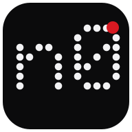
</p>

<h1 align="center">n0te</h1>

<p align="center">
  Handwritten notes on the tablet, the same notebooks on the laptop.<br>
  In sync, offline, peer to peer. No account, no server.
</p>

<p align="center">
  <a href="https://github.com/DiscoveryFox/n0te/releases/latest"></a>
  <a href="https://github.com/DiscoveryFox/n0te/actions/workflows/ci.yml"></a>
  
</p>

> **Deutsch:** n0te ist eine Notiz-App: mit dem Stift auf dem Android-Tablet schreiben, dieselben
> Notizbücher am Laptop (Windows, Linux) lesen, tippen, durchsuchen und exportieren, direkt
> synchronisiert, ohne Konto und ohne Server. n0te Laptop und n0te Tablet gibt es auf Deutsch
> und Englisch (folgt der Sprache von Windows), die Android-App ist auf Deutsch. Diese Seite ist auf Englisch; Downloads unter
> [Releases](https://github.com/DiscoveryFox/n0te/releases), Änderungen im [CHANGELOG](CHANGELOG.md).

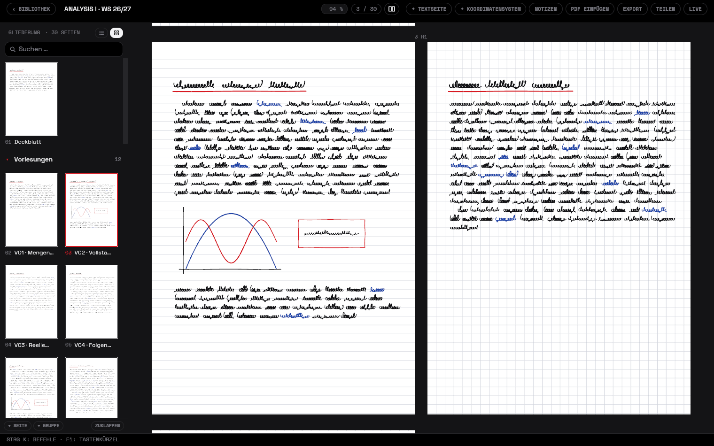

n0te is built around one notebook per course. On an Android tablet you write by hand: lecture
notes, exercise sheets, lecture slides imported as PDF, graphs and formulas. On the laptop you
open the very same notebooks to type, search, export and present, and you can watch the tablet
live while it writes. Every device keeps a full copy and edits made offline merge when the
devices meet again (CRDTs). Devices talk directly to each other, end-to-end encrypted over
[iroh](https://iroh.computer); classmates join a single notebook through an invite link.

## Which app do I want?

| App | For | Status | Get it |
|---|---|---|---|
| **n0te for Android** | Android tablets with a pen (S Pen and similar): the writing app | In daily use | `n0te-<version>-android.apk` from [Releases](https://github.com/DiscoveryFox/n0te/releases) |
| **n0te Laptop** | Windows and Linux, keyboard and mouse: read, organise, type, PDFs, graphs, live with the tablet | Linux: in daily use · Windows: new (x64 and ARM64), sync still being ported | Windows: installer or zip from [Releases](https://github.com/DiscoveryFox/n0te/releases) · Linux: [build from source](#build-from-source) |
| **n0te Tablet** | Windows pen and touch devices (Surface, Snapdragon laptops …): the Android app's tools on Windows | Preview: today it shows the n0te Laptop interface; pen input and the tablet tools are being built | Same Windows installer, tick "n0te Tablet" |

## Features

Legend: ● available · ◐ partly / built but not yet tried on real hardware (see note) · ○ planned · – not available

| Area | Android | n0te Laptop · Linux | n0te Laptop · Windows | n0te Tablet · Windows (preview) |
|---|:---:|:---:|:---:|:---:|
| [Ink and pens](#ink-and-pens) | ● | ◐ shows ink | ◐ shows ink | ◐ pens, marker, eraser, pressure, tilt, eraser end, palm, finger mode, ruler, writing magnifier, scribble to delete |
| [Shapes, arrows, lasso](#shapes-arrows-lasso) | ● | ◐ shows them | ◐ shows them | ◐ shapes, arrowheads, lasso (move, scale, copy), insert space |
| [Pages and notebooks](#pages-and-notebooks) | ● | ● | ● | ● |
| [PDF](#pdf) | ● | ● | ● | ● |
| [Text and LaTeX](#text-and-latex) | ● | ● | ◐ formulas need TeX | ◐ formulas need TeX |
| [Graphs](#graphs) | ● | ● | ● | ● |
| [Search](#search) | ● | ● | ● | ◐ reads handwriting with Windows' recognizer |
| [Library](#library) | ● | ● | ● | ● |
| [Designs](#designs) | ● | ● | ● | ● |
| [Two notebooks side by side](#two-notebooks-side-by-side) | ● | ● | ● | ● |
| [Sync and pairing](#sync-and-pairing) | ● | ● | ◐ | ◐ |
| [Live sessions](#live-sessions) | ● | ● | ◐ | ◐ |
| [Guests](#guests) | ● | ● | ◐ | ◐ |
| [Version history](#version-history) | – (the laptop keeps it) | ● | ◐ | ◐ |

n0te Laptop draws no ink by design: handwriting is the tablet's job. n0te Tablet for Windows is
n0te Laptop's interface plus the tablet's tools: the Windows pen (pressure, tilt, eraser end,
barrel button, hover, palm rejection), the tablet's pen types and palettes, eraser, lasso, shapes
and arrowheads (the same recognizers as the Android app, ported to the shared core), insert space,
ruler, writing magnifier, scribble to delete, the "+" at the page edges, boards on their own,
laser, text tool, finger mode and handwriting search. The Windows builds are new: they are built on GitHub
Actions and have not been tried on real Windows pen devices yet, so expect rough edges and
please report what you find.

The pictures below are n0te Laptop on Linux, taken headless from demo notebooks
(`scripts/screenshots.sh`); the handwriting in them is generated, so it is not meant to be read.

### Ink and pens

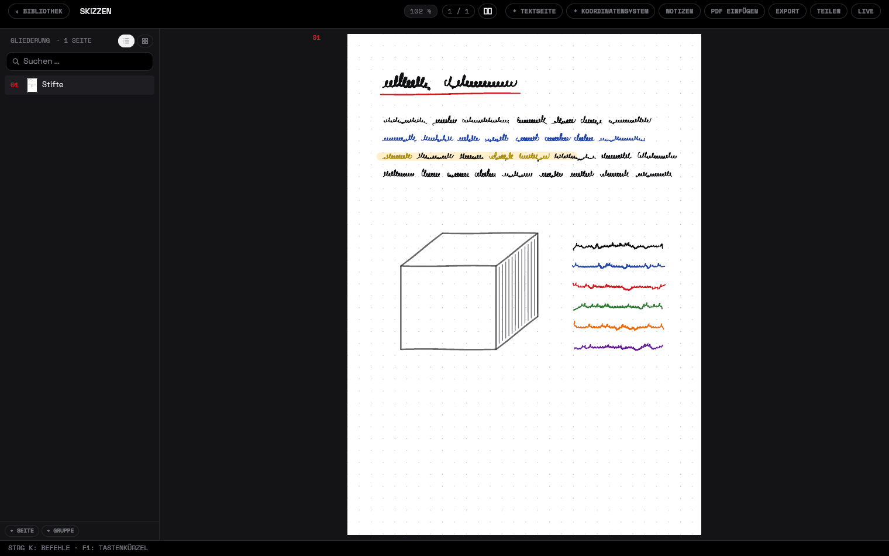

Fountain pen, ballpoint, pencil (with grain), brush and marker, in your colours and widths; ink
appears under the pen with low latency, and the hand can rest on the screen while writing.
*Example:* hold the width button and a slider appears; hold a colour for a picker with
pipette and palettes; the pen's side button erases; scribbling over a word deletes it. The laser
pointer leaves a short trail for presenting. The ruler moves with one finger and turns with
two, and the pen follows its edge; the writing magnifier (Schreiblupe) lets you write large in a
strip at the bottom while its frame moves along the page. *(Picture: n0te Laptop showing what the tablet wrote.)*

### Shapes, arrows, lasso

*Example:* draw a rough rectangle and hold the pen still at the end: it snaps into a clean
rectangle (or a straight line in 15° steps, a triangle, a circle); keep holding and drag to resize
it. Draw a line and then a small V at its end: it becomes a clean arrowhead, still in your hand's
style. Circle strokes with the lasso to move, scale, recolour, copy them into another notebook or
send them to the laptop's clipboard. Pen down and drag down or sideways to insert space.

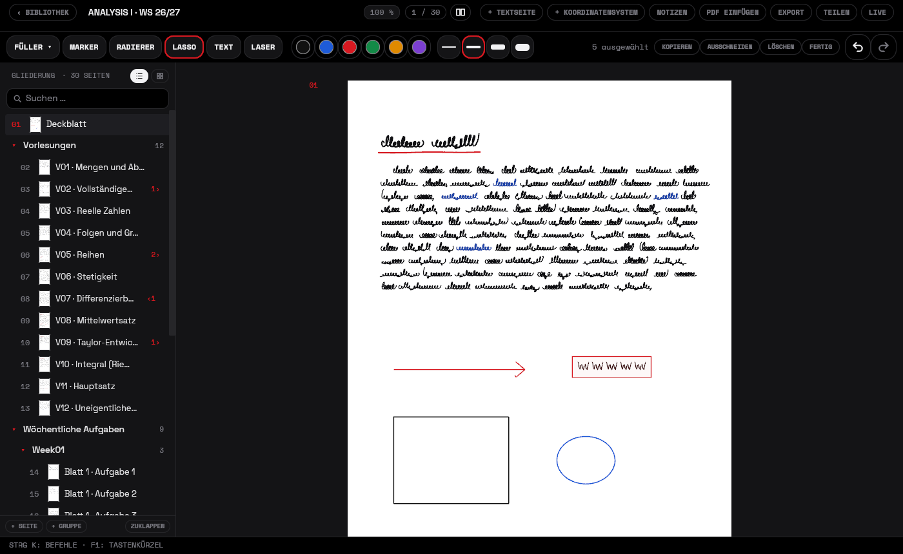

*(Picture: n0te Tablet, headless with the mouse as the pen; the same recognizers as on the
Android tablet.)*

### Pages and notebooks

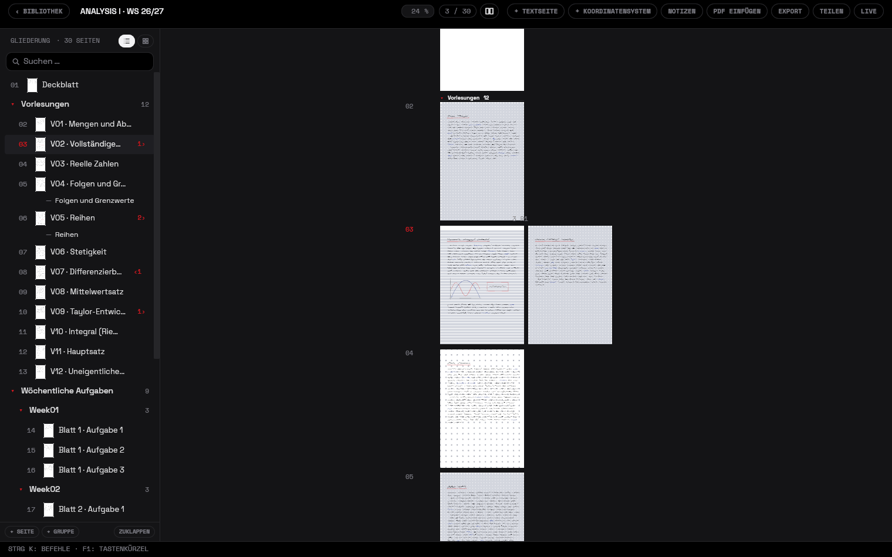

A notebook is a column of pages with nested, foldable groups ("Lectures › Week 3") and side pages
left and right of any page, plus infinite boards. Paper: blank, lines, squares (any size), dots,
Cornell; formats A3 to A6, Letter, square, 16:9 slide or your own size up to 5 m a side, portrait
or landscape. Even a 2 × 2 m page full of ink stays smooth: only what is in view is drawn.
*Example:* hold the `+` at the right edge of a page to add a side page there (or below it for the
next page); fold a group by its title; the outline shows page pictures and bookmarks; on the laptop
Page Down pages through and Ctrl+R turns a page to landscape.

### PDF

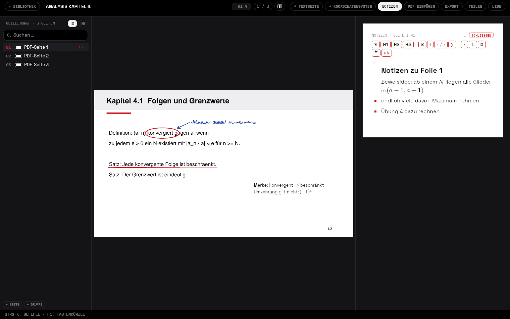

Import lecture slides, write on them on the tablet, add blank pages between or beside slides and
export everything, the current page or picked pages (any page or side page on its own). The ink is exported as vectors in its own
PDF layer ("n0te ink"), so it can be hidden in a PDF viewer. *Example:* drop a PDF into the laptop
window (or Ctrl+O); circle a term on the tablet; type a note next to the slide with Ctrl+M (the
notes column); Ctrl+E exports.

### Text and LaTeX

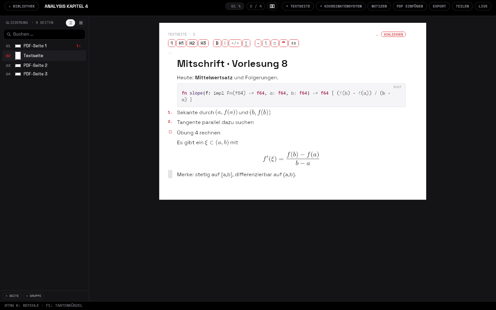

Text boxes anywhere on a page and whole text pages: headings, lists, checkboxes, quotes, code
blocks with highlighting, and LaTeX. *Example:* type `$\frac{f(b)-f(a)}{b-a}$` for a formula in the
line, `$$` on its own line for a centred one; `#`, `-`, `1.`, `[ ]` and ` ``` ` start headings,
lists, checkboxes and code. On the laptop a double click on a page makes a text box, Ctrl+N a text
page. The tablet renders formulas itself; the laptop uses a local TeX installation (`latex` and
`dvisvgm`, e.g. TeX Live; not tried on Windows yet).

### Graphs

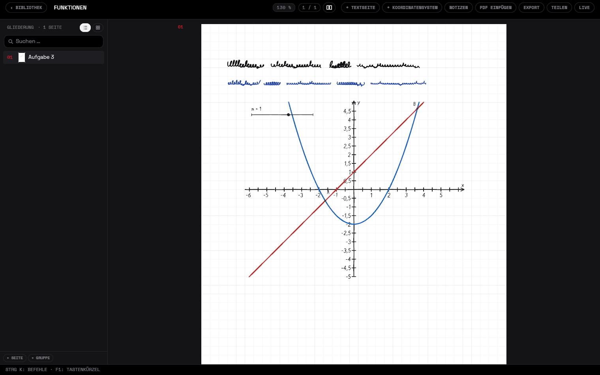

Coordinate systems on the page that stay editable, built like in GeoGebra: functions, points,
lines, circles, polygons, sliders, intersections, roots, extrema, tangents, integrals, with the
GeoGebra commands in German or English. On squared paper they snap to the squares, and they stay
ink: the same on every device and in the PDF. *Example:* type `f(x) = 0.5x^2 - 2` and
`g(x) = m x + 1`: `m` becomes a slider; `Schneide(f, g)` (or `Intersect(f, g)`) marks both
intersections as A and B, which follow when you move the slider.

<details>
<summary>Its editor: algebra view, slider, input line with the commands</summary>

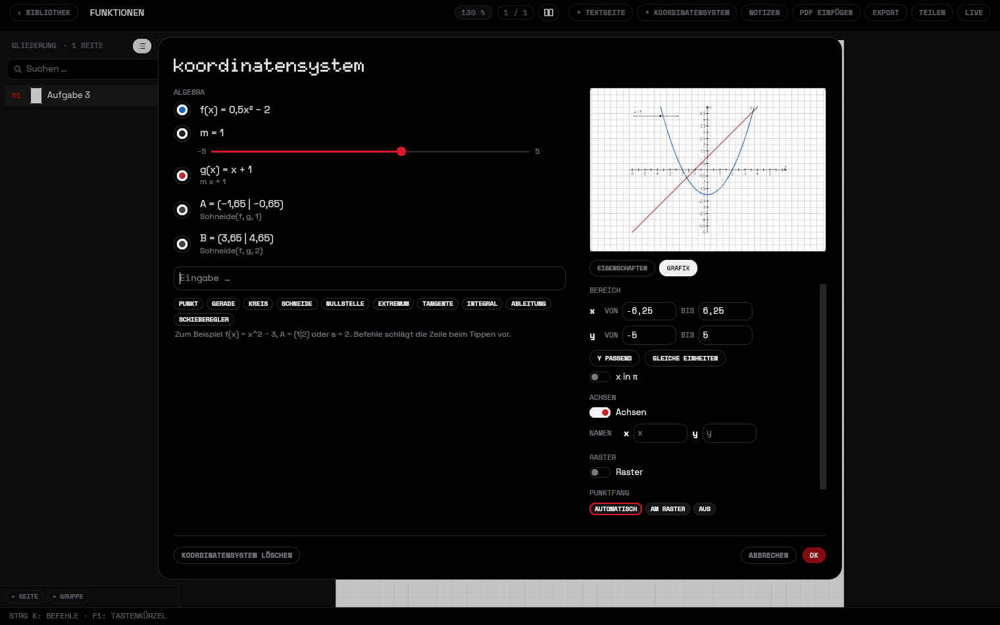

</details>

### Search

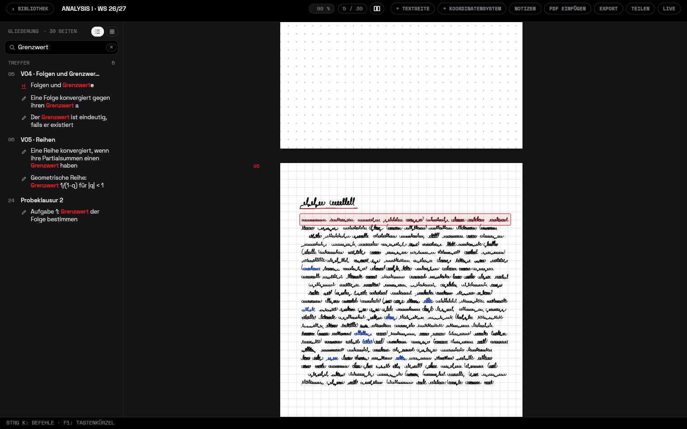

The tablet reads your handwriting on the device (Google ML Kit, offline after a one-time download
of about 20 MB), so search finds handwriting, typed text, headings and the text of PDFs, also with
small reading mistakes and without caring about case or umlauts. *Example:* Ctrl+F `Grenzwert`
lists the handwritten heading "Folgen und Grenzwerte" and the handwritten lines that mention it
("Eine Folge konvergiert gegen ihren Grenzwert a"), page by page; a click jumps there and lights
the spot up. Lasso a handwritten line and mark it as a heading: it shows up in the outline.

### Library

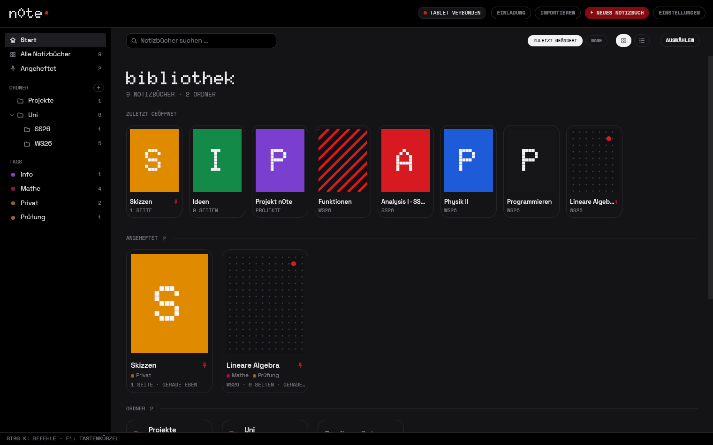

Folders inside folders, coloured tags, pinned notebooks, covers, search and sorting, a start page
with what you opened last. *Example:* drag a notebook onto "Uni › WS26" in the sidebar to file it;
select several to tag or move them at once.

### Designs

Fourteen designs, each with its own colours, shapes and fonts, the same on the tablet and on the
laptop:

- **Classic:** Nothing, Light, OLED, Ocean, Forest and Sepia.
- **Special:** Christmas (snowfall and fairy lights), Blueprint (a drafting grid), Chalkboard,
  Starry night (twinkling stars), Cherry blossom (falling petals), Autumn (falling leaves),
  Terminal (scanlines) and High contrast.

You can also **make your own design with an AI:**

1. Copy n0te's instructions (Settings › Design).
2. Paste them into ChatGPT, Claude or Gemini together with your idea.
3. Paste the answer back into n0te.

n0te checks the design and shows a preview. If something doesn't fit, it lists what the AI should
fix. A design file imports the same way on Android, Windows and Linux. The format and the rules
are in [docs/styles.md](docs/styles.md). Decorations only move behind the library, never while you
write, and can be switched off.

### Two notebooks side by side

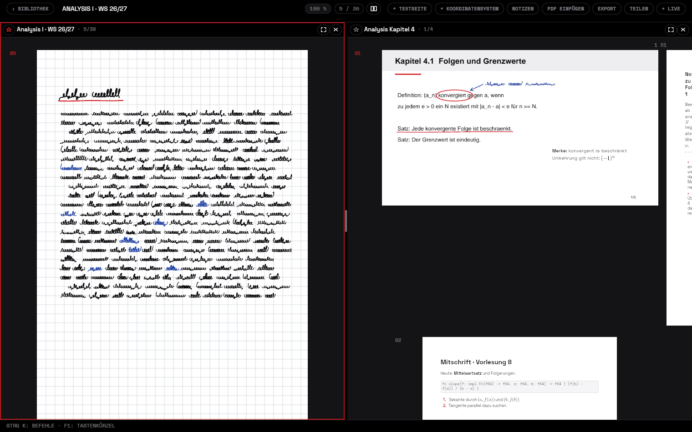

*Example:* `⧉` opens another notebook beside the current one, or the same notebook a second time
at another page (edits show in both at once, with one undo); drag a page out of the outline to the
edge to open it beside; the divider snaps at a third, half and two thirds.

### Sync and pairing

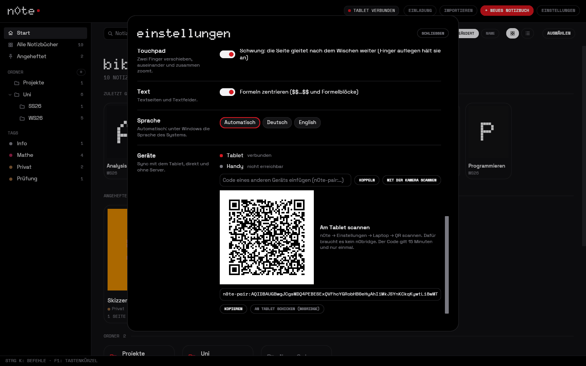

Pair once with a QR code, then notebooks, PDFs and images sync whenever both devices are online,
directly in the same network or through encrypted relays, and merge if both were edited offline.
On the laptop the small `n0te-sync` service keeps the library current even while the app is
closed. A device with a camera scans the QR code itself ("Mit der Kamera scannen", also on a
laptop's webcam). See [Pairing quickstart](#pairing-quickstart).

### Live sessions

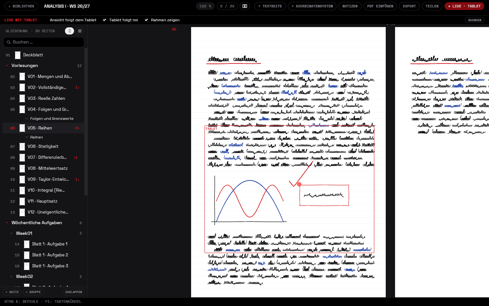

*Example:* press LIVE on the laptop and the tablet opens the same notebook; the laptop shows where
the tablet looks, its laser pointer and every stroke while it is being written. Either side can
follow the other, so the laptop on a projector shows what you write on the tablet.

### Guests

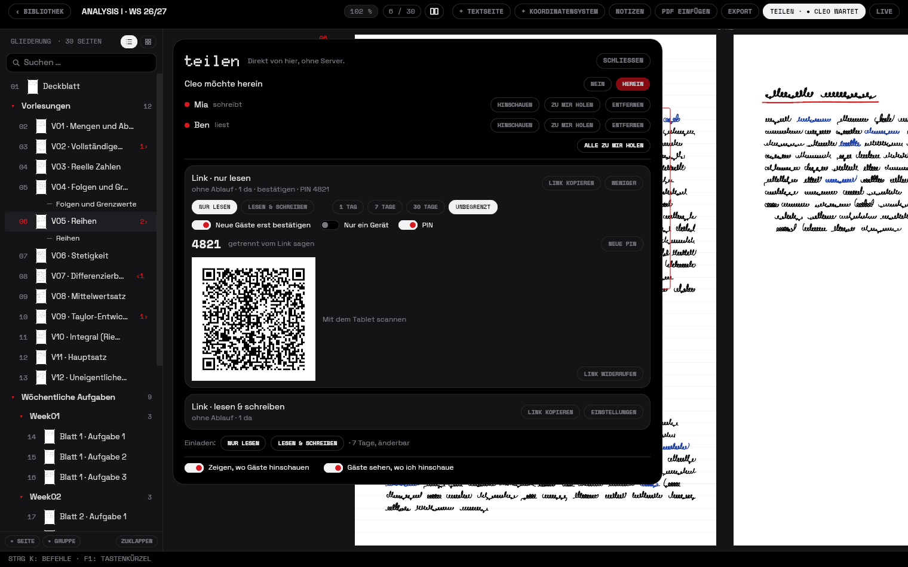

Share one notebook, read-only or read and write, without any server: an invite link (`n0te://invite/…`)
or its QR code. *Example:* send a classmate a read-only link with a PIN; let them in when they
knock; see where they look, bring them to your page, switch them to read and write, or remove a
single guest. Links can expire after a day, a week, a month or never.

### Version history

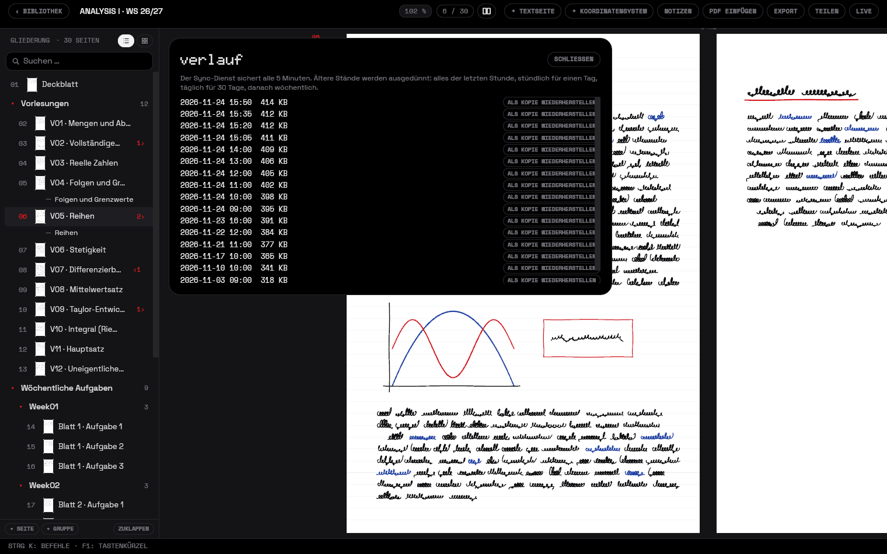

The laptop's sync service keeps checkpoints of every notebook: everything from the last hour,
hourly for a day, daily for a month, weekly after that, each one verified. *Example:* Ctrl+H in a
notebook lists them; "restore as copy" brings back an old state as a new notebook next to the
current one.

## Install

### Windows

1. From the [latest release](https://github.com/DiscoveryFox/n0te/releases/latest) download
   `n0te-<version>-windows-x64-setup.exe` (Intel and AMD PCs) or
   `n0te-<version>-windows-arm64-setup.exe` (Snapdragon and other ARM PCs).
2. Run it. It needs no administrator rights and installs for your user into
   `%LOCALAPPDATA%\Programs\n0te`. Pick n0te Laptop, n0te Tablet or both.
3. The programs are not code-signed yet, so SmartScreen may say "Windows protected your PC"
   (unknown publisher): click **More info → Run anyway**. Compare the file with `SHA256SUMS.txt`
   from the release if you like (`Get-FileHash <file>` in PowerShell).

The installer adds Start menu entries, opens `.n0te` files with n0te Laptop, registers `n0te://`
invite links for n0te Tablet (or n0te Laptop; a click on a link opens the join dialog with it)
and starts n0te-sync at sign-in, which keeps your notebooks in sync even with the apps closed.
Uninstall it under Settings → Apps; your notebooks in
`%APPDATA%\n0te` stay.

**Portable:** `n0te-<version>-windows-<arch>-portable.zip` has the same programs. Unpack and run
`n0te-laptop.exe` or `n0te-tablet.exe`; nothing is registered and nothing starts by itself.

### Android

1. Download `n0te-<version>-android.apk` from a release that has one (releases carry the APK
   once release signing is set up).
2. Open it on the tablet and allow your browser or file manager to install apps.

Needs Android 10 or newer on an arm64 device. For updates enter `DiscoveryFox/n0te` under
Einstellungen → Updates: n0te then finds new releases, downloads them in the background and asks
before installing.

### Linux

No packages yet: build n0te Laptop and n0te-sync [from source](#build-from-source), then

```sh
install -Dm755 target/release/n0te ~/.local/bin/n0te
install -Dm755 target/release/n0te-sync ~/.local/bin/n0te-sync
install -Dm644 third_party/pdfium/linux-x64/lib/libpdfium.so ~/.local/lib/n0te/libpdfium.so
install -Dm644 packaging/n0te.desktop ~/.local/share/applications/n0te.desktop
install -Dm644 packaging/n0te.svg ~/.local/share/icons/hicolor/scalable/apps/n0te.svg
install -Dm644 packaging/n0te-mime.xml ~/.local/share/mime/packages/n0te.xml
install -Dm644 packaging/n0te-sync.service ~/.config/systemd/user/n0te-sync.service
update-mime-database ~/.local/share/mime
systemctl --user daemon-reload && systemctl --user enable --now n0te-sync
```

The library lives in `~/.local/share/n0te`.

## Pairing quickstart

1. On the laptop, make sure n0te-sync runs (Linux: `systemctl --user enable --now n0te-sync`).
2. In n0te Laptop open Einstellungen (settings, Ctrl+,) → Geräte (devices) → **Tablet koppeln**:
   a QR code and a text code appear, valid for 15 minutes and for one device.
3. On the tablet: n0te → Einstellungen → Laptop → **QR scannen** (or paste the code).
4. Done. Notebooks now flow both ways whenever both devices are online. Press LIVE in a notebook
   on the laptop to open it on the tablet; TEILEN (Share) creates guest links.

Sync on Windows follows once n0te-sync is ported (in progress).

## Releases

[](https://github.com/DiscoveryFox/n0te/releases/latest)

All downloads are on the [releases page](https://github.com/DiscoveryFox/n0te/releases). One
version number covers the Android app, n0te Laptop, n0te Tablet and n0te-sync; every release lists
its changes (from [CHANGELOG.md](CHANGELOG.md)) and has these files:

| File | What |
|---|---|
| `n0te-<version>-windows-x64-setup.exe` | Windows installer, Intel/AMD |
| `n0te-<version>-windows-arm64-setup.exe` | Windows installer, ARM (Snapdragon) |
| `n0te-<version>-windows-<arch>-portable.zip` | The same programs without installing |
| `n0te-<version>-android.apk` | The Android app (when release signing is set up) |
| `SHA256SUMS.txt` | Checksums of all files |

| Version | Date | Highlights |
|---|---|---|
| [0.35.0](https://github.com/DiscoveryFox/n0te/releases/tag/v0.35.0) | 2026-11-26 | Your own designs written with an AI; eight new designs incl. Christmas with snowfall; crash reports; a big bug hunt (data safety, crashes, Windows) with a real test suite; much faster library and long notebooks |
| [0.34.1](https://github.com/DiscoveryFox/n0te/releases/tag/v0.34.1) | 2026-11-26 | Guests of several notebooks stay connected; dialogs with long notes scroll |
| [0.34.0](https://github.com/DiscoveryFox/n0te/releases/tag/v0.34.0) | 2026-11-25 | Export single pages and side pages; huge pages stay smooth; n0te Tablet gets the ruler, insert space, writing magnifier, scribble to delete, "+" and boards; pairing with the webcam |
| [0.33.0](https://github.com/DiscoveryFox/n0te/releases/tag/v0.33.0) | 2026-11-25 | Graphs with domains, axes stretched separately, implicit/parametric/polar curves, fractions; open PDFs with n0te; fast big selections |
| [0.32.1](https://github.com/DiscoveryFox/n0te/releases/tag/v0.32.1) | 2026-11-24 | Automatic updates from this repo (Windows and Android) |
| [0.32.0](https://github.com/DiscoveryFox/n0te/releases/tag/v0.32.0) | 2026-11-24 | First public release: the Android app, n0te Laptop for Windows and Linux, n0te Tablet for Windows as a preview; insert space sideways on the tablet |

Versions before 0.32.0 were private builds of the Android app; their history is in the
[CHANGELOG](CHANGELOG.md#history-before-the-public-release).

## Build from source

```sh
git clone https://github.com/DiscoveryFox/n0te && cd n0te
scripts/fetch-pdfium.sh linux-x64          # pinned, hash-checked pdfium
cargo build --release -p n0te-desktop -p n0te-sync
cargo test --workspace
```

Needs Rust (rustup, stable) and on Linux the Wayland and xkbcommon headers. The Android app
builds with `cd android && gradle assembleRelease` (Android SDK 35, NDK 27.2, Gradle 9.9, the
`aarch64-linux-android` Rust target). Windows builds, the installer, screenshots and releases:
[docs/DEVELOPMENT.md](docs/DEVELOPMENT.md).

## License

Copyright © 2026 DiscoveryFox. **All rights reserved.** n0te is not open source: the code is
public to read, and the official release builds may be installed and used; see [LICENSE](LICENSE).
Third-party components keep their own licenses, listed in
[THIRD_PARTY_NOTICES.md](THIRD_PARTY_NOTICES.md).
